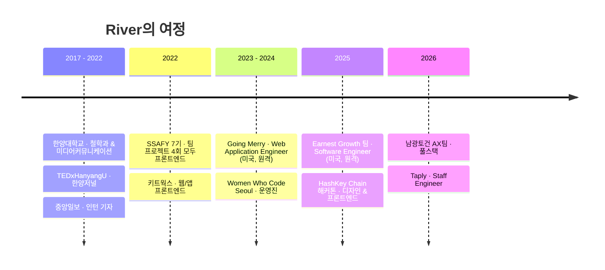

<div align="center">

<p><a href="./README.md">English</a> · <b>한국어</b></p>


<p><b>김혜린 (Hyerin April Kim)</b> · <b>Taply</b> Staff Engineer</p>

<picture>
  <source media="(prefers-color-scheme: dark)" srcset="https://readme-typing-svg.demolab.com?font=Noto+Sans+KR&weight=500&size=20&duration=3000&pause=900&repeat=false&color=38BDF8&center=true&vCenter=true&width=500&lines=%EC%B2%A0%ED%95%99%EA%B3%BC+%EB%AF%B8%EB%94%94%EC%96%B4+%E2%86%92+%EA%B8%B0%EC%9E%90+%E2%86%92+%EA%B0%9C%EB%B0%9C%EC%9E%90;%ED%94%84%EB%A1%A0%ED%8A%B8%EC%97%94%EB%93%9C%EB%A5%BC+%EC%A4%91%EC%8B%AC%EC%9C%BC%EB%A1%9C%2C+%ED%95%84%EC%9A%94%ED%95%98%EB%A9%B4+%ED%92%80%EC%8A%A4%ED%83%9D%EA%B9%8C%EC%A7%80;%EC%9E%91%EC%9D%80+%EB%B3%80%EA%B2%BD%EC%9D%B4+%EC%88%AB%EC%9E%90%EB%A1%9C+%EB%8F%8C%EC%95%84%EC%98%A4%EB%8A%94+%EC%9D%BC%EC%9D%84+%EC%A2%8B%EC%95%84%ED%95%B4%EC%9A%94;%EB%B0%B0%EC%9A%B4+%EA%B2%83%EC%9D%80+Riverlog%EC%97%90+%EA%B8%B0%EB%A1%9D%ED%95%A9%EB%8B%88%EB%8B%A4" />
  
</picture>

<p>
  <a href="https://riverlog-five.vercel.app"></a>
  <a href="https://riverlog-five.vercel.app/portfolio"></a>
  <a href="mailto:aprilhyerinkim@gmail.com"></a>
</p>

</div>

---

## 🌊 소개

대학에서 **철학과 미디어**를 공부했고, **기자**를 준비하다 **데이터 저널리즘**을 거쳐 개발을 만났습니다.
2022년 **SSAFY**에서 개발을 처음 제대로 배운 뒤로는 웹 프론트엔드를 중심으로, 필요하면 앱과 서버까지 오가며 일해 왔어요.

작은 변경이 숫자로 돌아오는 일을 좋아합니다. 조금 덜 흔들리는 레이아웃, 온보딩 화면 문구 한 줄, URL 끝의 슬래시 하나 같은 것들이요.
배운 것은 블로그이자 지식 창고인 [Riverlog](https://riverlog-five.vercel.app)에 기록합니다.

```ts
const river = {
  name: "김혜린 (Hyerin April Kim)",
  goesBy: "River",
  now: "Taply(핀테크) Staff Engineer",
  basedIn: "서울 · 2023~2026년 미국 팀과 원격 협업",
  background: ["철학", "미디어커뮤니케이션", "소프트웨어공학"],
  focus: ["프론트엔드", "그로스 실험(A/B 테스트, SEO)", "Three.js", "AI 코딩 워크플로"],
  writes: "2022년부터 쓴 TIL, 지금은 Riverlog에",
};
```

---

## 강물이 흘러온 길



---

## 숫자로 돌아온 변화

<div align="center">

| 성과 | 어디서 |
|:--|:--|
| 구글 오가닉 검색 클릭 **+220%** (팀 성과) · 평균 순위 **7.5 → 4.3** | Earnest · WordPress → Next.js + Storyblok 이전과 SEO |
| 실험 한 달 만에 대출 체결 **+16%** · Lighthouse CLS **0.06** | Earnest · 온보딩 퍼널 실험 |
| 제품 참여도 전년 대비 **+30%** · 2024년 신규 도구 **3개** 출시 | Going Merry · 학생 대시보드, Appeal Letter Generator, College Match |
| 포털 하나에 사내 서비스 **11개** · 송장–타설 자동 매칭률 **94%** | 남광토건 · 공통 조직 데이터(SSOT) 기반 AXWORKS 포털 |
| 지원자 1인 경력 산정 **30분 → 3분** · 기술자 경력 **1,488명** DB화 | 남광토건 · AI 기반 경력 산정 시스템 |
| 반 **최우수상** & **우수상** | SSAFY · 무플리, 책크인 |

</div>

---

## 기술 스택

<div align="center">

**프론트엔드**<br/>


**백엔드 & 데이터**<br/>


**인프라 & 도구**<br/>


</div>

---

## 대표 프로젝트

| 프로젝트 | 소개 | 기술 |
|:--|:--|:--|
| [**Riverlog**](https://riverlog-five.vercel.app) | 2022년부터 쌓은 TIL을 다듬어 만든 블로그 + 지식 창고 | Next.js, TypeScript |
| [**싼타클리닉**](https://github.com/HerrineKim/ssanta-clinic) | 3D 산타 마을과 웹 어드벤트 캘린더 | React, Recoil, Three.js |
| [**무플리**](https://github.com/HerrineKim/movie-playlist) | 영화 OST와 명대사로 추천하는 영화 커뮤니티 · **최우수상** | Vue, Django, TMDB API |
| [**책크인**](https://github.com/HerrineKim/chaek-in) | 독서 기록 기반 도서·독서 모임 추천 앱 · **우수상** | React Native, Expo |
| [**코딩 위드 미**](https://github.com/HerrineKim/coding-with-me) | 웹 IDE와 컴파일러를 갖춘 1:N 실시간 코딩 교육 | Vue 3, WebRTC, Spring Boot |
| [**HashScope**](https://hashscope.vercel.app) | AI 에이전트용 토큰 정산 API 플랫폼, 해커톤에서 2.5일 만에 제작 | Next.js, shadcn/ui, MetaMask |
| [**my-dev-settings**](https://github.com/HerrineKim/my-dev-settings) | 내 Claude Code 스킬과 개발 환경 설정 | Python, Shell |

---

## 코드 밖에서

- **TEDxHanyangU** 오거나이저, **Women Who Code Seoul** 운영진으로 활동했어요
- **한양저널** 기자, **중앙일보** 인턴 기자로 글을 썼어요
- 2023년에 **Three.js**와 **Blender**를 공부했어요 ([threejs-study](https://github.com/HerrineKim/threejs-study), [blender-study](https://github.com/HerrineKim/blender-study))

<div align="center">


<sub>들러 주셔서 고마워요. 더 많은 기록은 <a href="https://riverlog-five.vercel.app">Riverlog</a>에 있어요.</sub>

</div>
