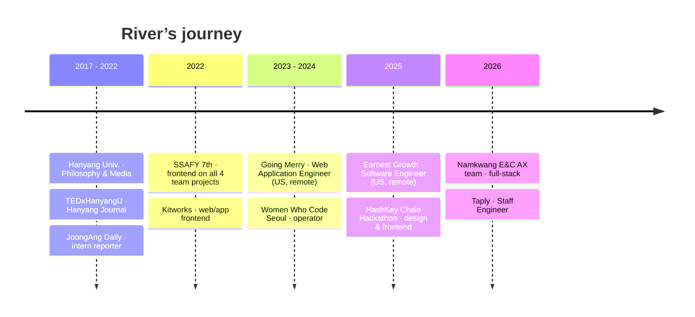

<div align="center">

<p><b>English</b> · <a href="./README.ko.md">한국어</a></p>


<p><b>Hyerin (April) Kim</b> · Staff Engineer at <b>Taply</b></p>

<picture>
  <source media="(prefers-color-scheme: dark)" srcset="https://readme-typing-svg.demolab.com?font=Fira+Code&weight=500&size=20&duration=3000&pause=900&repeat=false&color=38BDF8&center=true&vCenter=true&width=500&lines=Philosophy+%26+Media+%E2%86%92+Journalism+%E2%86%92+Code;Frontend+at+heart%2C+full-stack+when+needed;I+like+changes+that+come+back+as+numbers;Writing+what+I+learn+on+Riverlog" />
  
</picture>

<p>
  <a href="https://riverlog-five.vercel.app"></a>
  <a href="https://riverlog-five.vercel.app/portfolio"></a>
  <a href="mailto:aprilhyerinkim@gmail.com"></a>
</p>

</div>

---

## 🌊 About Me

I studied **philosophy and media**, trained as a **reporter**, wandered into **data journalism**, and that is where I met code.
Since **SSAFY** in 2022 I have been building on the web: frontend at heart, crossing over to apps and servers whenever the problem asks for it.

I like work where a small change comes back as a number: a layout that shifts a little less, one line of onboarding copy, a trailing slash in a URL.
And I write things down. What I learn goes into **[Riverlog](https://riverlog-five.vercel.app)**, my blog and personal knowledge base.

```ts
const river = {
  name: "Hyerin (April) Kim",
  goesBy: "River",
  now: "Staff Engineer @ Taply (fintech)",
  basedIn: "Seoul, KR · worked remotely with US teams, 2023-2026",
  background: ["Philosophy", "Media & Communications", "Software Engineering"],
  focus: ["Frontend", "Growth experiments (A/B tests, SEO)", "Three.js", "AI coding workflows"],
  writes: "TIL since 2022, now on Riverlog",
};
```

---

## Where the River Has Flowed



---

## Changes That Came Back as Numbers

<div align="center">

| Impact | Where |
|:--|:--|
| **+220%** Google organic search clicks (team) · avg. rank **7.5 → 4.3** | Earnest · WordPress → Next.js + Storyblok migration & SEO |
| **+16%** loan closings in one month · Lighthouse CLS **0.06** | Earnest · onboarding funnel experiments |
| **+30%** product engagement YoY · **3** new tools shipped in 2024 | Going Merry · student dashboard, Appeal Letter Generator, College Match |
| **11** internal services on one portal · **94%** invoice–pour auto-match | Namkwang E&C · AXWORKS portal with shared org data (SSOT) |
| Career evaluation per applicant **30 min → 3 min** · **1,488** engineers digitized | Namkwang E&C · AI-based career evaluation |
| **1st** place (class) & **Excellence Award** | SSAFY · Mupli (Movie Playlist), Chaek-in |

</div>

---

## Tech Stack

<div align="center">

**Frontend**<br/>


**Backend & Data**<br/>


**Infra & Tools**<br/>


</div>

---

## Featured Projects

| Project | What it is | Built with |
|:--|:--|:--|
| [**Riverlog**](https://riverlog-five.vercel.app) | My blog + knowledge base, grown from TIL notes since 2022 | Next.js, TypeScript |
| [**Ssanta Clinic**](https://github.com/HerrineKim/ssanta-clinic) | A 3D Santa village & web advent calendar | React, Recoil, Three.js |
| [**Mupli**](https://github.com/HerrineKim/movie-playlist) | Movie Playlist: recommendations by OST & famous lines · **1st place** | Vue, Django, TMDB API |
| [**Chaek-in**](https://github.com/HerrineKim/chaek-in) | Book & reading-club recommendation app · **Excellence Award** | React Native, Expo |
| [**Coding With Me**](https://github.com/HerrineKim/coding-with-me) | 1:N live coding class with web IDE & compiler | Vue 3, WebRTC, Spring Boot |
| [**HashScope**](https://hashscope.vercel.app) | Token-metered API platform for AI agents, built in 2.5 days at a hackathon | Next.js, shadcn/ui, MetaMask |
| [**my-dev-settings**](https://github.com/HerrineKim/my-dev-settings) | My Claude Code skills & dev environment | Python, Shell |

---

## Beyond Code

- Organized **TEDxHanyangU** and ran **Women Who Code Seoul** as an operator
- Wrote as a reporter for **The Hanyang Journal** and interned at **Korea JoongAng Daily**
- Solved LeetCode problems with the **DaleStudy** study group
- Studied **Three.js** and **Blender** in 2023 ([threejs-study](https://github.com/HerrineKim/threejs-study), [blender-study](https://github.com/HerrineKim/blender-study))

<div align="center">


<sub>Thanks for stopping by. More notes on <a href="https://riverlog-five.vercel.app">Riverlog</a>.</sub>

</div>
